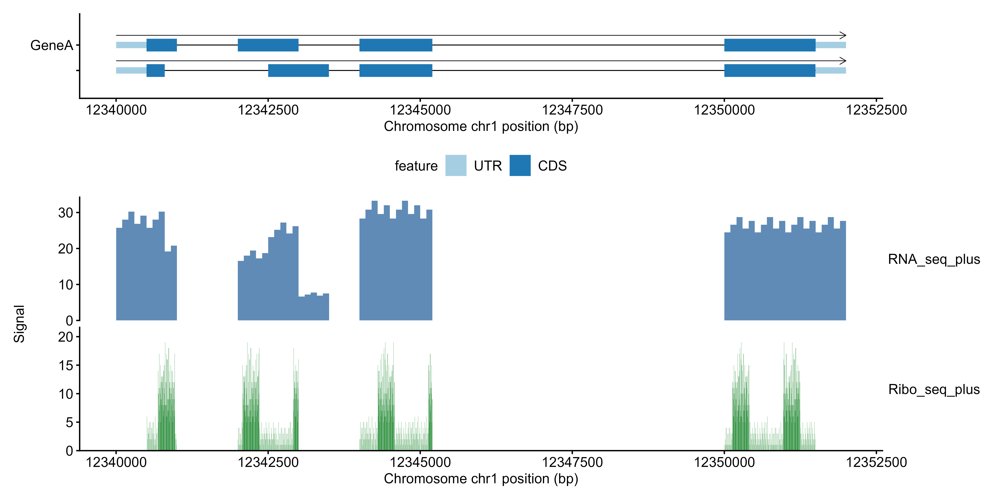
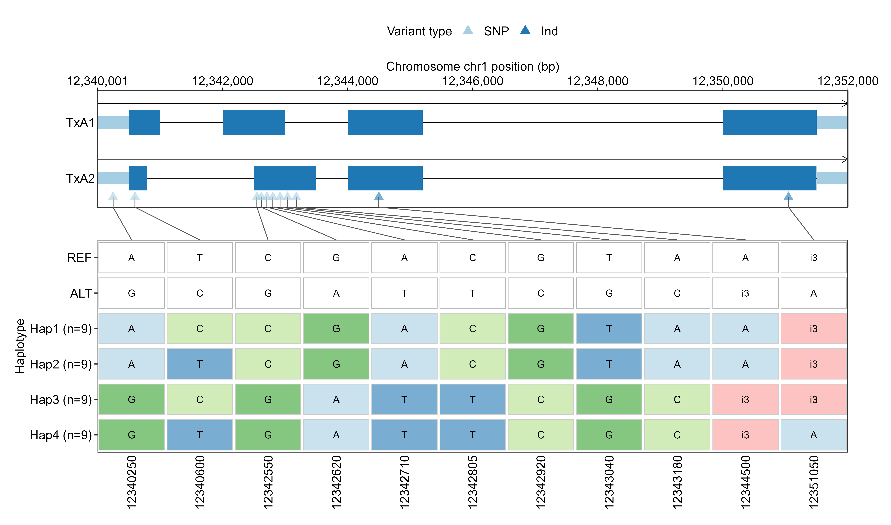
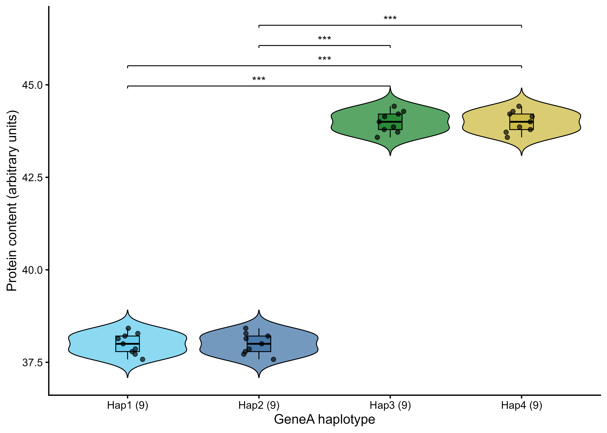

<!-- Generated from README.qmd by tools/render_readme.R. Edit README.qmd. -->

# GeneTrackR

Genomic track visualization and haplotype analysis in R.

[Documentation](https://renscq.github.io/GeneTrackR/) ·
[Getting started](https://renscq.github.io/GeneTrackR/articles/getting-started.html) ·
[Function reference](https://renscq.github.io/GeneTrackR/reference/index.html) ·
[Issues](https://github.com/Renscq/GeneTrackR/issues)

GeneTrackR connects gene annotations, RNA-seq/Ribo-seq signals, variants,
haplotypes and phenotypes in one programmable workflow. It supports:

- GenePred/GenePredExt, GTF, GFF3 and BED annotation;
- bedGraph, wig and bigWig signals, plus VCF variants;
- integrated locus plots, haplotype construction, phenotype comparisons,
  linkage disequilibrium and haplotype refinement;
- structured analysis tables, standard-format export and `GRanges` interchange.



The bundled synthetic GeneA locus combines gene models and strand-specific
RNA-seq/Ribo-seq signals on a shared genomic axis. Signal tracks have
independent y-axis ranges; these values are not biological measurements.

## Installation

GeneTrackR requires **R 4.6.0 or later** and is currently a Bioconductor
submission candidate. Until it is available in a Bioconductor release,
install the development source from GitHub:

```r
if (!requireNamespace("BiocManager", quietly = TRUE)) {
  install.packages("BiocManager")
}
if (!requireNamespace("remotes", quietly = TRUE)) {
  install.packages("remotes")
}
BiocManager::install(c("GenomicRanges", "IRanges", "S4Vectors"))
remotes::install_github(
  "Renscq/GeneTrackR",
  dependencies = TRUE,
  build_vignettes = FALSE
)
```

Once the package is available in your Bioconductor release, the recommended
installation will be:

```r
BiocManager::install("GeneTrackR")
```

`Rsamtools` is optional and enables tabix-indexed regional queries. Core
in-memory workflows and the examples below do not require it.

## Recommended entry points

| Task | Recommended functions |
|---|---|
| Read annotation files | `read_genepred()`, `read_gtf()`, `read_gff()`, `read_bed()` |
| Construct annotations from an interval table | `Feature()` |
| Enter from existing Bioconductor ranges | `as_feature(gr)` |
| Read signal tracks | `read_bwg()` |
| Read variants | `read_vcf()` |

`FeatureTrack()` and `read_vcf_track()` remain supported compatibility aliases
of `Feature()` and `read_vcf()`, respectively. Each alias accepts the same
arguments and returns the same objects as its recommended entry point.

For an existing `GRanges` object, use `as_feature(gr)` to enter the interval
workflow and `as_granges(feature, level = "feature")` to return to Bioconductor.
The feature-level round trip retains sequence information, range names and
metadata, with standard annotation columns following Feature's normalization
and genomic sorting. See [Annotation and Bioconductor ranges](https://renscq.github.io/GeneTrackR/articles/annotation.html#existing-granges)
for an executable example and the supported metadata rules.

## Quick start: inspect a gene locus

The package includes deterministic synthetic data; no external data download
is needed. Read the annotation and two strand-specific signal tracks, then
draw them over the same gene interval:

```r
library(GeneTrackR)

gp <- read_genepred(
  system.file("extdata", "gtr_demo.genePredExt", package = "GeneTrackR"),
  format = "genePredExt",
  verbose = FALSE,
  progress = FALSE
)

signal <- read_bwg(
  system.file(
    "extdata",
    c("gtr_demo_rnaseq_plus.bedgraph", "gtr_demo_riboseq_plus.bedgraph"),
    package = "GeneTrackR"
  ),
  sample_names = c("RNA_seq_plus", "Ribo_seq_plus"),
  strand = c("+", "+"),
  mode = "memory",
  verbose = FALSE
)

p <- plot_tracks(
  annotation = gp,
  signal = signal,
  gene_id = "GeneA",
  strand = "+",
  signal_y_ticks = "pretty",
  signal_colors = c(RNA_seq_plus = "#4477AA", Ribo_seq_plus = "#228833"),
  layout = "gene_top",
  plot_theme = "classic",
  text_size = 11
)
p
```

The resulting plot is illustrated above. The x-axis uses genomic coordinates.

## From variants to haplotypes and phenotypes

Use the bundled VCF and phenotype table with the same annotation object:

```r
vcf <- read_vcf(
  system.file("extdata", "gtr_demo_variants.vcf", package = "GeneTrackR"),
  mode = "memory",
  keep_genotype = TRUE,
  verbose = FALSE,
  progress = FALSE
)
pheno <- read_pheno(
  system.file("extdata", "gtr_demo_pheno.tsv", package = "GeneTrackR"),
  verbose = FALSE,
  progress = FALSE
)
hap <- hap_gene_variant(
  vcf, annotation = gp, gene_id = "GeneA", genotype_mode = "string"
)
plot_hap_variant(
  hap, annotation = gp, min_hap_samples = 3,
  variant_label = "pos", gene_track_legend_position = "top"
)
```



The GeneA example contains 11 gene-body variants and 36 complete samples,
forming four haplotypes with nine samples each. Sample matching uses
`sample_id`, rather than row order.

```r
association <- plot_hap_pheno(
  hap,
  phenotype = pheno,
  traits = "protein_content",
  min_hap_samples = 3,
  test_method = "t.test",
  p_adjust = "BH",
  p_value_type = "adjusted",
  show_points = TRUE
)
association$figure
association$summary
association$pvalue
```



The gallery uses the bundled synthetic `protein_content` values in arbitrary
units. Pairwise comparisons use two-sided Welch t-tests with Benjamini–Hochberg
correction across the six comparisons; displayed significance labels use
adjusted P values. All 36 samples are retained in the comparison.

## Documentation

The six numbered workflows in `vignettes/` are published on the package
website. Start with **Getting started and the example data**, then choose the
workflow for your task. **Complete workflow** connects locus inspection to
haplotype and phenotype analysis. Retired article URLs redirect to the
corresponding workflow or section.

| Task | Tutorials |
|---|---|
| 01 Start and inspect the data model | [Getting started and example data](https://renscq.github.io/GeneTrackR/articles/getting-started.html) |
| 02 Work with annotations, signals and GRanges | [Annotation and Bioconductor ranges](https://renscq.github.io/GeneTrackR/articles/annotation.html) |
| 03 Analyze variants, haplotypes and LD | [Variants, haplotypes and LD](https://renscq.github.io/GeneTrackR/articles/haplotype.html) |
| 04 Compare traits and inspect refinement/effects | [Phenotypes and refinement](https://renscq.github.io/GeneTrackR/articles/phenotype.html) |
| 05 Connect the candidate-locus evidence | [Complete workflow](https://renscq.github.io/GeneTrackR/articles/complete-workflow.html) |
| 06 Export tracks, results and provenance | [Export and reproducibility](https://renscq.github.io/GeneTrackR/articles/export-results.html) |

All internal genomic coordinates are **1-based closed**. Readers and writers
handle the source-format coordinate conventions; consult the annotation and
signal tutorials before combining external tracks.

For installations that include built vignettes, local documentation is also
available with `browseVignettes("GeneTrackR")`.

## Citation and support

Use the citation for the package version used in your analysis:

```r
citation("GeneTrackR")
```

Report reproducible problems at
[GitHub Issues](https://github.com/Renscq/GeneTrackR/issues), including your
GeneTrackR version and `sessionInfo()`.

## License

GeneTrackR is distributed under **GPL-3**, as declared in `DESCRIPTION`.
